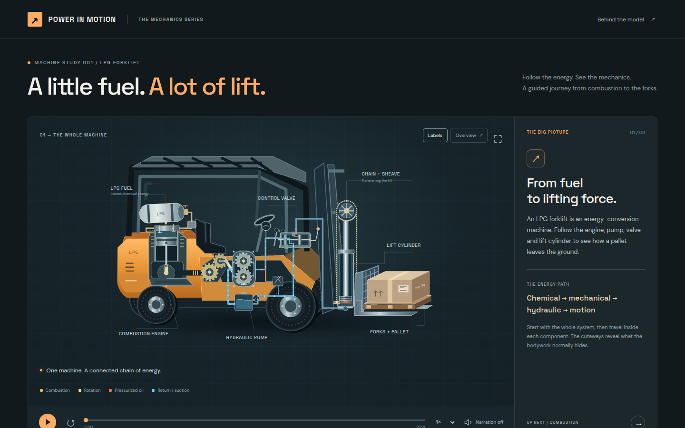

# Forklift — Power in Motion

**An interactive, narrated explainer of how an LPG forklift turns fuel into lift: combustion → mechanical → hydraulic → motion.**



**Highlights**
- A 2:54 guided walkthrough in nine chapters, from the whole machine into the engine, pump, control valve, cylinder and chain lift.
- An interactive hydraulics lab where load and rpm drive cylinder pressure, pump flow and lift speed from a physics model.
- Unit-tested mechanics: force balance, flow vs. speed, load holding, relief pressure, chain and connecting-rod kinematics.
- Buildless (native SVG, JavaScript and CSS), with CI that checks the physics and deploys to GitHub Pages.

**Built with** OpenAI Codex, from a written brief through review and iteration. Stack: vanilla JS, SVG, Node test runner and GitHub Actions.

---

A buildless interactive animation following an LPG forklift's lifting powertrain. The 2:54 walkthrough starts with the whole machine, enters the combustion engine, pulls back to follow the mechanical power take-off, then follows hydraulic flow through the pump, control valve, cylinder and chain lift.

## Run locally

```sh
npm start
```

Open http://localhost:5173. No npm dependency installation or build is required. The start command uses Python 3's static server. Any static web server can serve `dist/`.

## GitHub Pages

The included `.github/workflows/pages.yml` checks the JavaScript and mechanics, then publishes only `dist/` to GitHub Pages when `main` changes. Set the repository's **Settings → Pages → Source** to **GitHub Actions**, then push or run the workflow. The deployment reports the live URL in its `github-pages` environment. Relative asset URLs support a project site under a repository-name path, including on a phone.

## Controls

- Play/pause, replay, speed, timeline and nine chapter buttons.
- Click a component or label to inspect it. Overview returns to the complete system while the chapter continues.
- Optional browser speech narration, labels and fullscreen.
- Raise / Hold / Lower enter the interactive lab. Load changes required cylinder pressure; rpm changes pump flow and raising speed. The lab is independent of the guided timeline.
- Space toggles playback; left/right arrows change chapters when focus is outside a control. The animation starts paused and respects reduced-motion camera preferences.

## Technical model and checks

```sh
npm run check
```

`dist/physics.js` contains the ideal hydraulic model and slider-crank / chain kinematics. Tests cover force balance, flow versus speed, neutral load holding, gravity lowering, relief pressure, constant chain length and connecting rod length. The app uses native SVG, JavaScript and CSS. Google Fonts are optional; system fallbacks work offline.

The representative system uses a vapor-fueled, four-stroke spark-ignition engine; a mechanically driven external gear pump; an open-center valve with a blocked cylinder port in neutral; a single-acting cylinder; and ideal 2:1 chain reeving. A 60 mm bore, 10 cm³/rev pump, 150 kg carriage, 0.75 m cylinder stroke and 120 bar relief setting are illustrative. The guided sequence slows each mechanism for instruction. The manual lab uses the model's flow-derived speed at 0.45× time scale. Friction, leakage, transient compressibility, traction, steering and mast tilt are omitted.

Sources are linked in the app's “Model & sources” dialog. All imagery is an original, editable SVG drawing; no external image assets or runtime libraries are needed.
